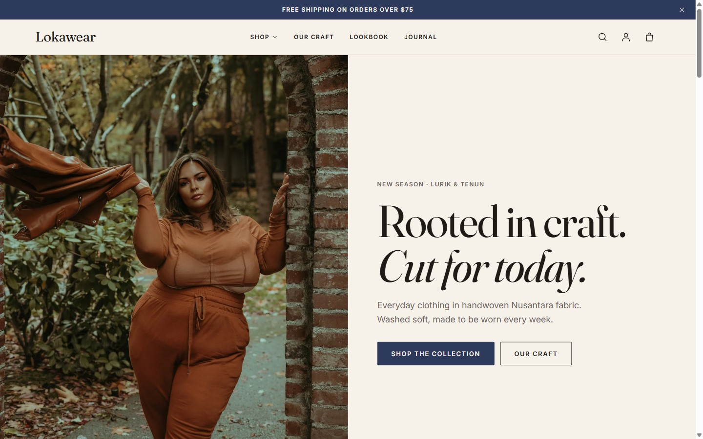
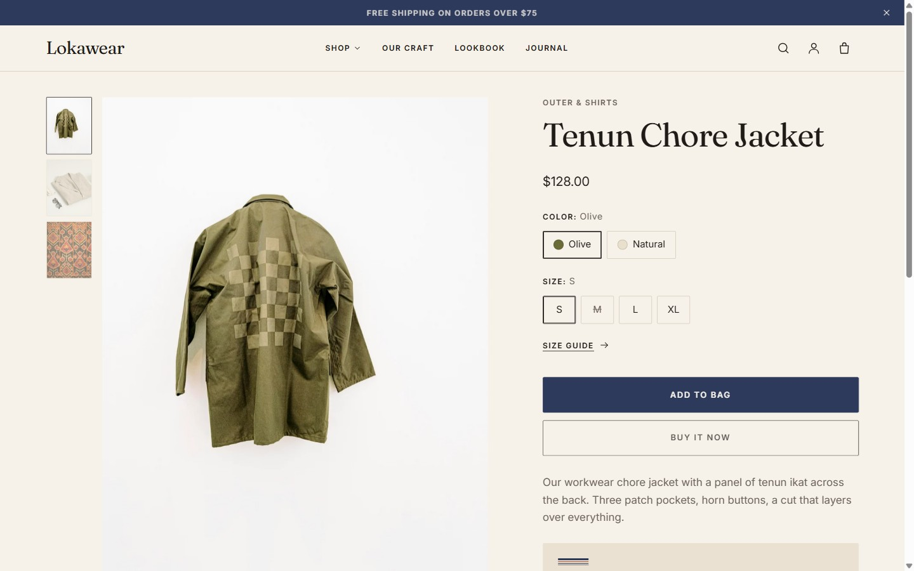
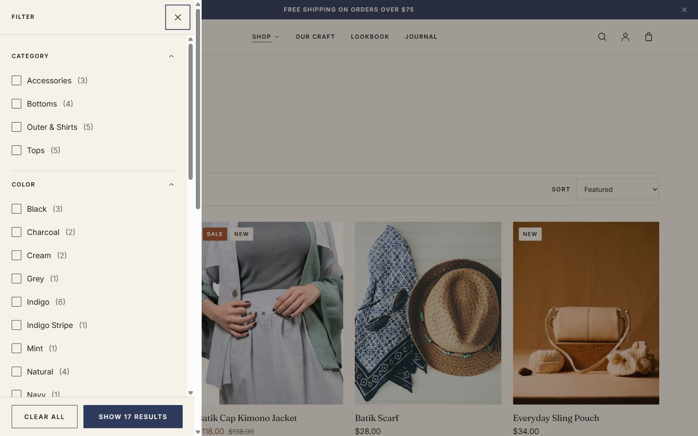
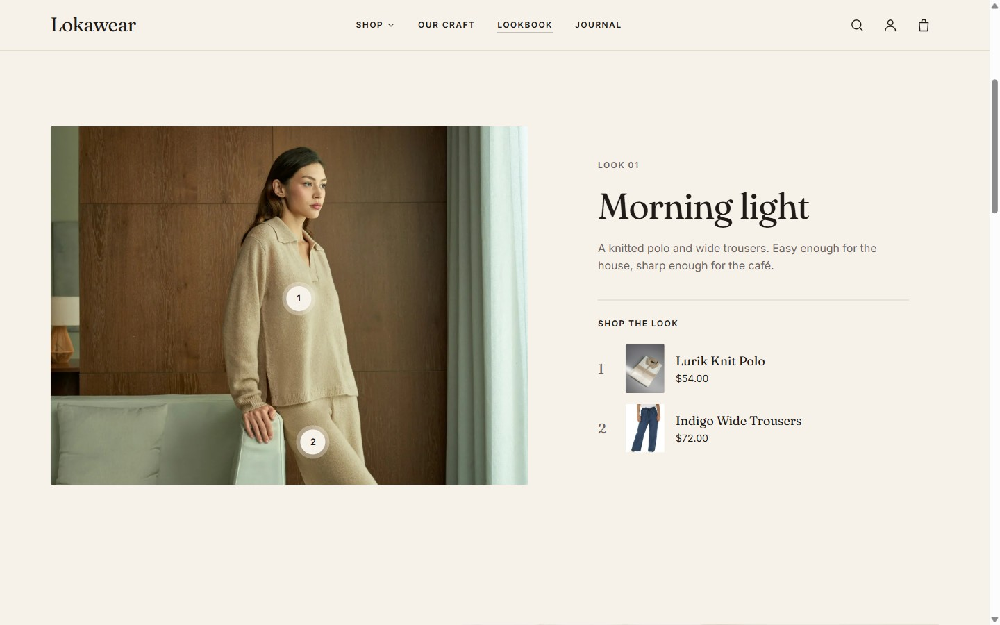
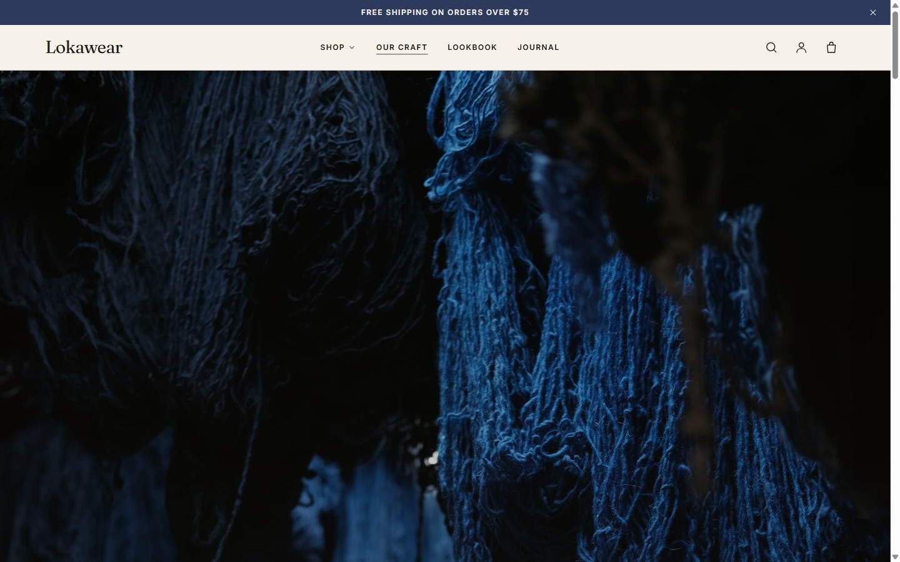

# Lokawear: custom Shopify theme

A custom Online Store 2.0 theme for **Lokawear**, a fictional brand that turns Indonesian handwoven textiles (lurik, tenun ikat, batik cap) into everyday clothing. I built it from Shopify's Skeleton theme. No page builder, no paid apps, no frameworks.

> Demo store for portfolio purposes. Nothing is for sale and no orders are fulfilled.



| Product page | Collection filters |
|---|---|
|  |  |
| **Lookbook with product pins** | **Our Craft with metaobject makers** |
|  |  |

## What I built

**Theme architecture**
- JSON templates and section groups (header, footer). Every section has settings and blocks a merchant can edit in the theme editor.
- A design system with theme settings: Shopify font library fonts, colour tokens, page width and corner radius.
- Scoped CSS through `` and a small `critical.css`. Plain JavaScript with Web Components and no build step.

**Shopping experience**
- **Product page:**
  - The gallery has thumbnails and a full-screen zoom.
  - Colour swatches and size buttons cross out unavailable combinations.
  - A size guide drawer reads from a `size_chart` metaobject.
  - A "Fabric story" block reads from product metafields and an `artisan` metaobject.
  - A sticky add-to-cart bar appears on mobile.
  - Recommendations load from the Product Recommendations API.
- **Variant switching uses the Section Rendering API.** Price, availability and buttons always come from Liquid, not from duplicated client-side logic.
- **Cart drawer:**
  - Built with the AJAX Cart API.
  - Shows a free-shipping progress bar.
  - Handles quantity changes and order notes.
  - Keeps focus in place after each update.
- **Collection and search pages:**
  - Storefront filters (Search & Discovery), sorting and pagination all update without a reload.
  - Removable filter pills.
  - Browser back and forward work.
  - Without JavaScript, the filters still work as a normal form.
- **Predictive search drawer** with product, collection and query suggestions.
- **Mega menu** with promo images.

**Content pages**
- **Our Craft:** brand story, craft sections, and maker cards generated from the `artisan` metaobject.
- **Lookbook:** editorial photos with numbered product pins and a "Shop the look" list.
- **Journal:** blog and article templates, plus contact, FAQ (with `FAQPage` structured data) and 404 pages.

**Quality**
- **Accessibility:**
  - Native `<dialog>` drawers trap focus and close with Esc.
  - Skip link and visible focus states.
  - 44px tap targets.
  - WCAG AA colour contrast.
  - `prefers-reduced-motion` support.
- **SEO:** product, article and FAQ structured data, plus meta description fallbacks.
- **Performance:**
  - Responsive `srcset` images.
  - The LCP image is preloaded with high fetch priority.
  - Below-the-fold images and recommendations load lazily.
  - No layout shift (CLS ≈ 0).

Lighthouse (mobile) on the home, product and collection pages: **Accessibility 100, SEO 100**.

## Data model

| Type | Key | Used for |
|---|---|---|
| Product metafield | `custom.fabric_origin`, `custom.technique` | Fabric story block |
| Product metafield | `custom.care_instructions` (multi-line) | Care accordion |
| Product metafield → metaobject | `custom.artisan` → `artisan` (name, region, craft, photo, bio) | Fabric story, Our Craft makers |
| Product metafield → metaobject | `custom.size_chart` → `size_chart` (name, table) | Size guide drawer |
| Automated collections | Product type, tag `new` | Category pages, New arrivals |

The 17 demo products (117 variants, including sold-out sizes and sale prices) are in [docs/lokawear-products.csv](docs/lokawear-products.csv) in Shopify's import format.

## Run it locally

Requires [Shopify CLI](https://shopify.dev/docs/api/shopify-cli) and Node 20+.

```bash
shopify theme dev --store <your-store>   # local preview with hot reload
shopify theme check                      # lint, must report no offenses
```

### Tests

End-to-end and accessibility tests use Playwright and axe-core. They run against the dev server:

```bash
npm install
npx playwright install chromium          # or set PW_CHANNEL=msedge / chrome
npm run test:e2e
```

The tests cover:
- Variant availability, the URL and add to bag.
- The size guide.
- Filters and sorting.
- Predictive search.
- WCAG 2.1 AA checks on eight templates, at desktop and mobile sizes.

To test a password-protected store, set `BASE_URL` and `STORE_PASSWORD`.

GitHub Actions runs Theme Check and a JavaScript syntax check on every push ([workflow](.github/workflows/theme-check.yml)).

## Project structure

```
assets/      critical.css, theme.js (dialogs, reveal, sliders, predictive search),
             product.js, cart-drawer.js, facets.js
sections/    page sections and their schemas
snippets/    product-card, price, facets, product-grid, article-card, icon, ...
templates/   JSON templates, including page.about / page.lookbook / page.faq / page.contact
tests/e2e/   Playwright specs
docs/        PRD, product CSV, photo sourcing, screenshots, credits
```

## Notes

- **Currency:** the development store's base currency is locked to USD, so prices are real USD amounts (for example $98), not converted Rupiah.
- **Photos:** all images are free [Unsplash](https://unsplash.com/license) photos. See [docs/CREDITS.md](docs/CREDITS.md) for every photographer.
- **Fonts:** Fraunces and Inter from the Shopify font library.
- **Base theme:** started from [Shopify Skeleton theme](https://github.com/Shopify/skeleton-theme) (MIT, see [LICENSE.md](LICENSE.md)).

Built by [M. Rezky Revansyah](https://github.com/rezkyrevansyah).
